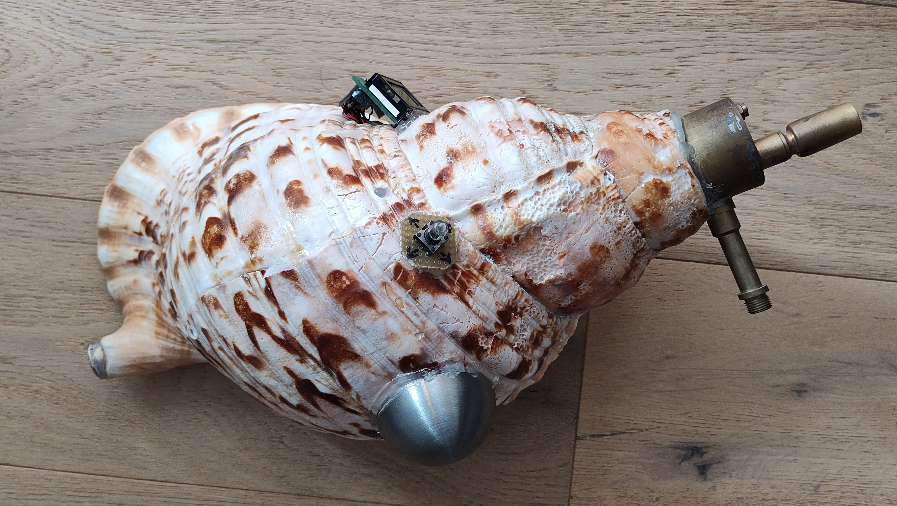
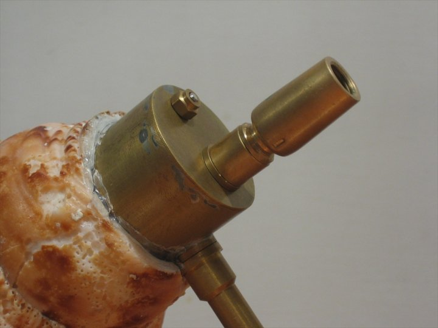
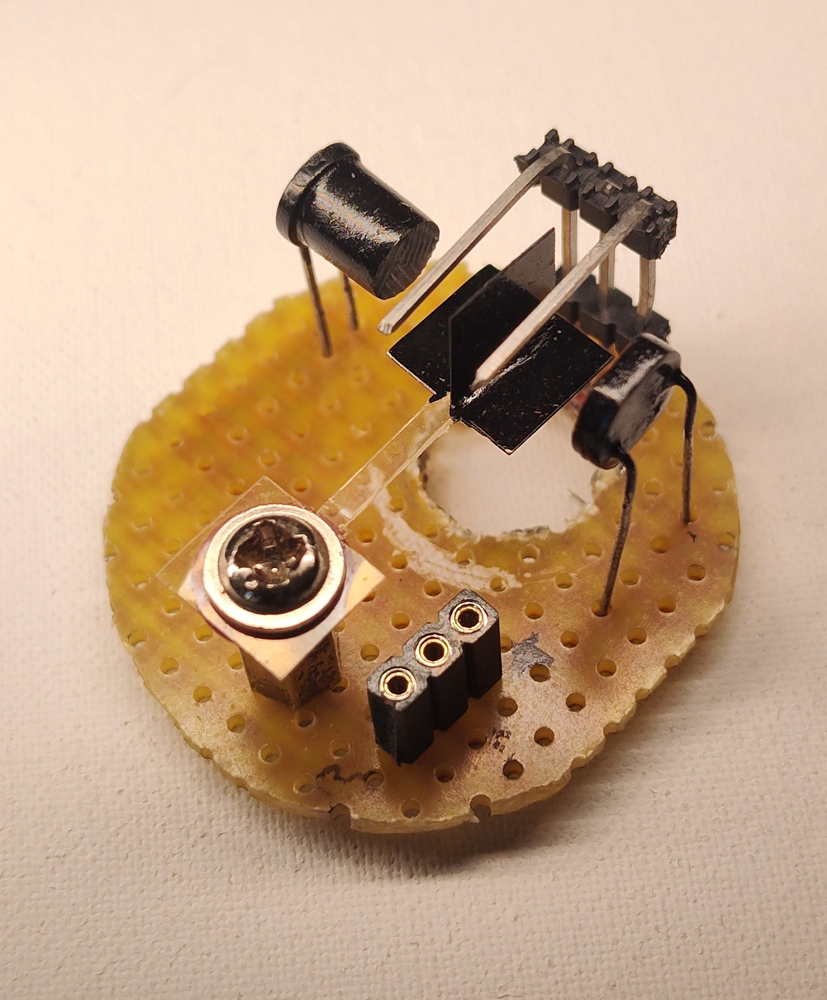
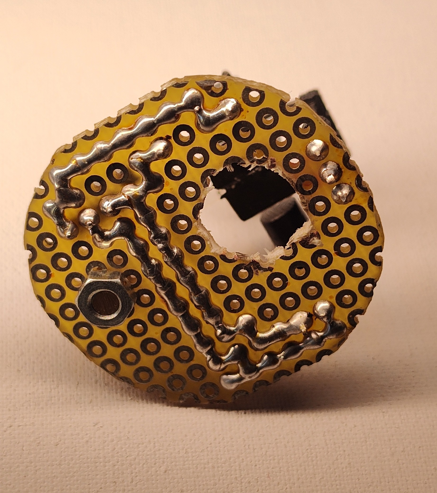
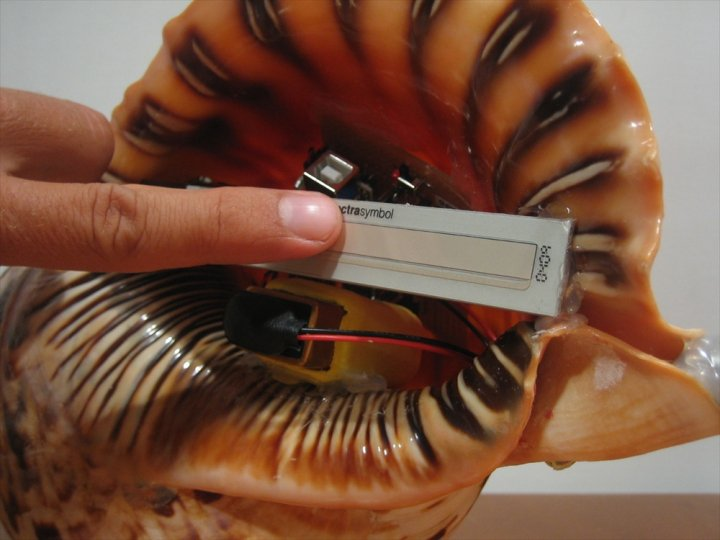
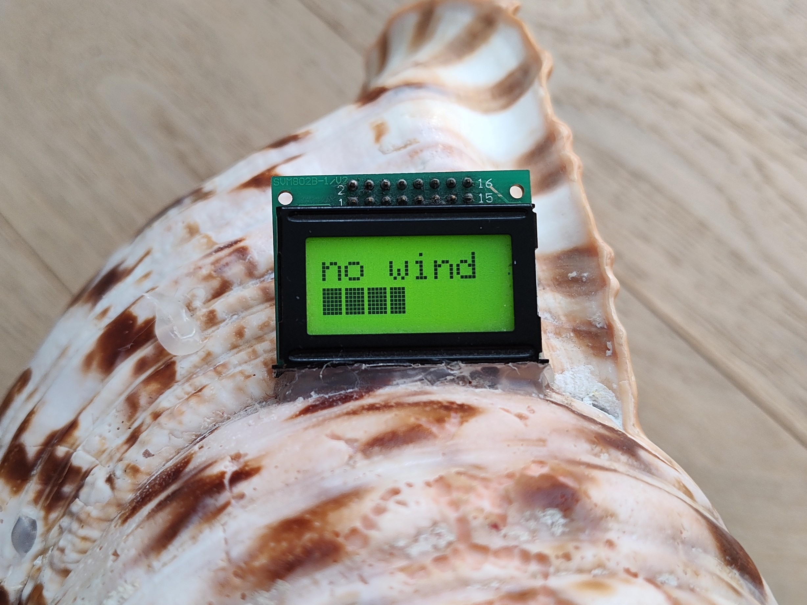
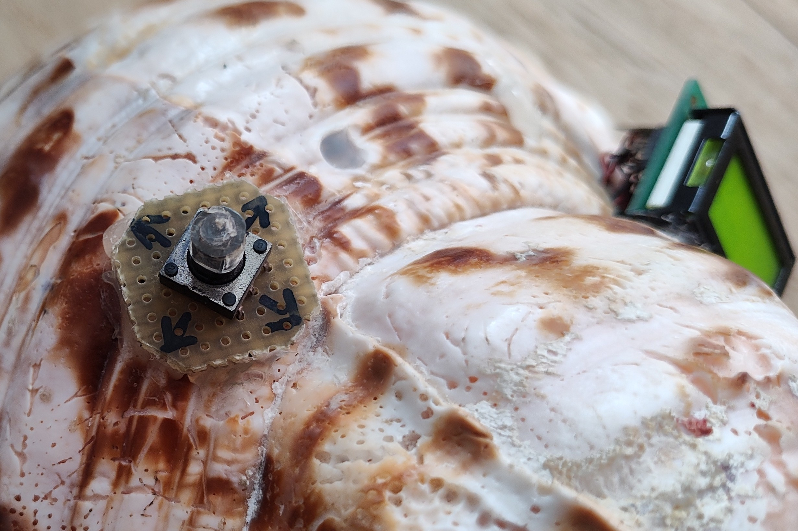
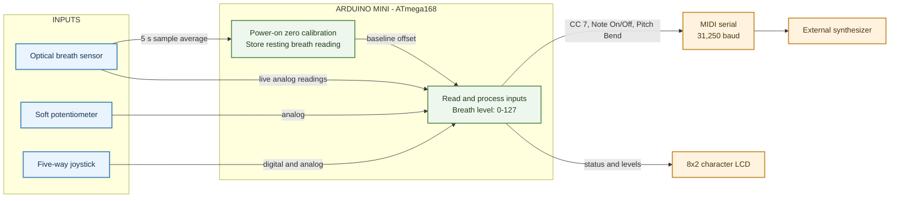
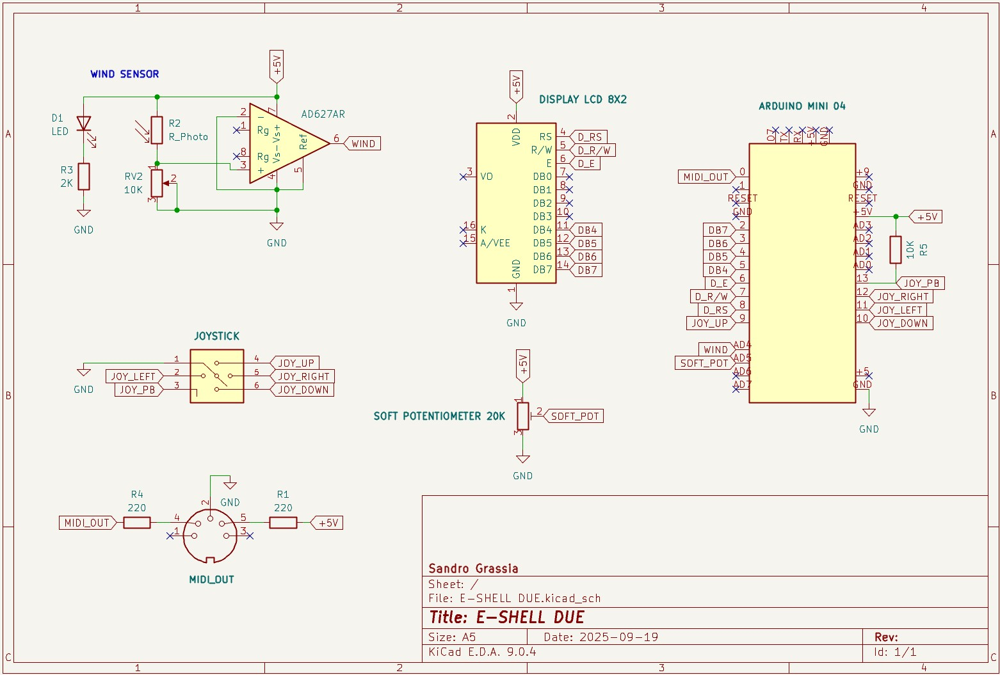

# Midi-Wind-Shell

This wind MIDI controller is housed inside a shell. It was designed and built in 2011 using an Arduino Mini 04. Other microcontrollers may also work, provided they have at least two analog inputs and twelve digital GPIO pins.
It can send clusters of up to four notes to an external synthesizer.

Breath pressure controls the volume (MIDI CC 7), and the mouthpiece is mounted on top of the shell.

The breath sensor is an optical design made from an LED, a photoresistor, and a dark barrier. Breath moves the barrier, changing how much light from the LED reaches the photoresistor.

Inside the shell, a soft potentiometer provides pitch modulation.

A simple 8×2 character LCD with a parallel interface displays the breath level and pitch-bend position.

A five-way joystick selects the root note and note cluster. It also lets you configure the MIDI channel, pitch-bend range, and pitch-bend message format (MSB and LSB, or MSB only).

## Technical overview

The controller reads an optical breath sensor, a soft potentiometer, and a five-way joystick. It maps the breath sensor reading to a 7-bit value from 0 to 127 (128 levels), which controls MIDI volume (Control Change 7). A value of 3 or higher triggers a Note On for the selected root note and chord; before that, the controller sends Note Off for the previously tracked root note and chord. When the breath value falls below 1, it resets the breath-detection state so another note can be triggered; this transition does not itself send Note Off. The soft potentiometer controls pitch bend, while the joystick selects the root note and chord and provides access to the MIDI channel, pitch-bend range, and message resolution settings. MIDI data is sent over the serial port at 31,250 baud to an external synthesizer. An 8x2 LCD with a parallel interface displays breath level, pitch bend, and setup information.

### Power-on calibration

At startup, the controller displays `CAL 5s` and takes breath-sensor readings at 10 ms intervals for five seconds, while displaying `NO BLOW`. It averages these readings and stores the result as the zero-pressure offset. Keep the mouthpiece unblown during calibration so the offset represents the sensor's resting level. Subsequent readings are measured relative to this baseline, then mapped and clamped to the 0-127 breath level. This is a one-point zero calibration, not a multi-point calibration. The offset is sampled again when entering the setup menu. The soft potentiometer is not zero-calibrated at startup; its touch position is tracked when it is first touched.

*Schematics*

