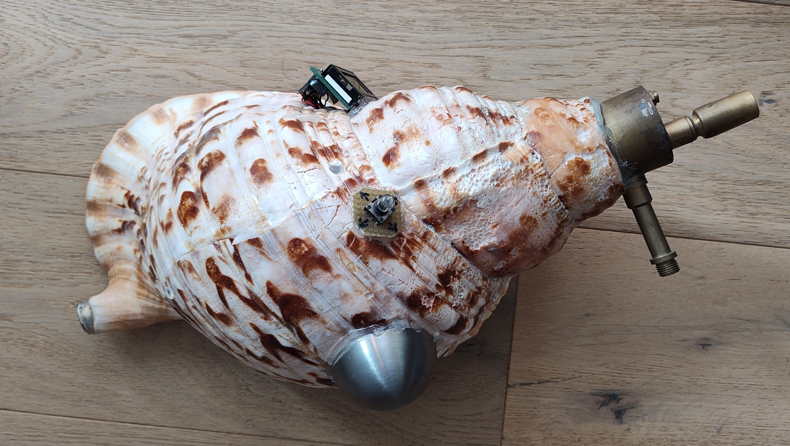
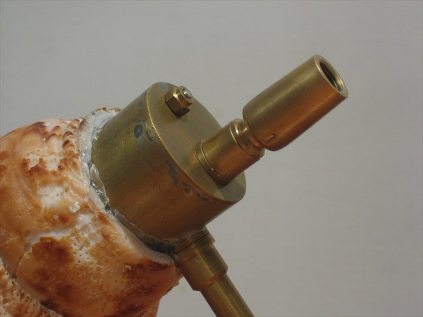
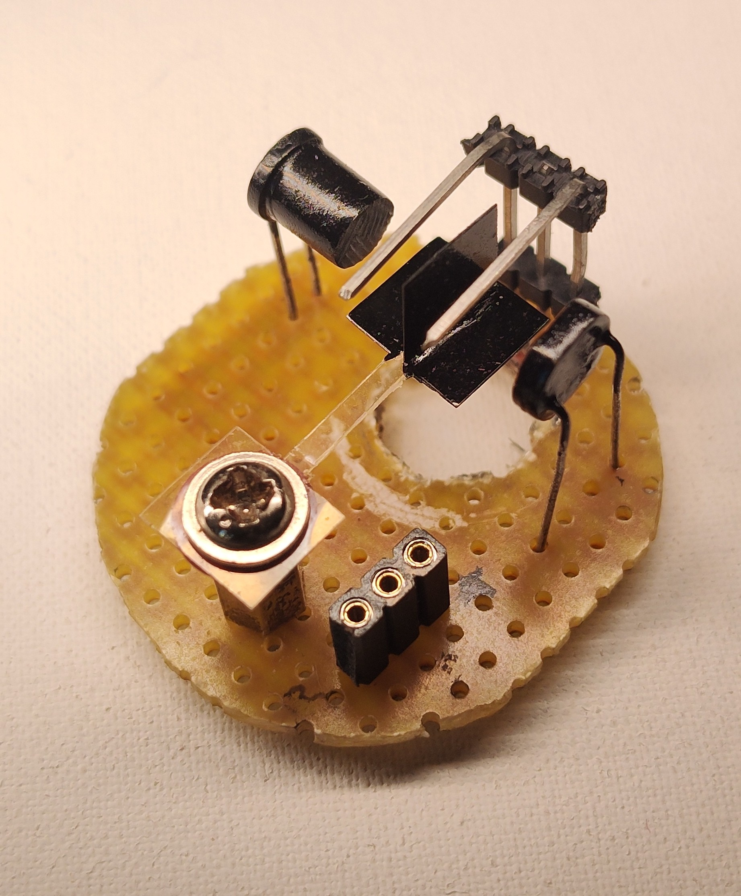
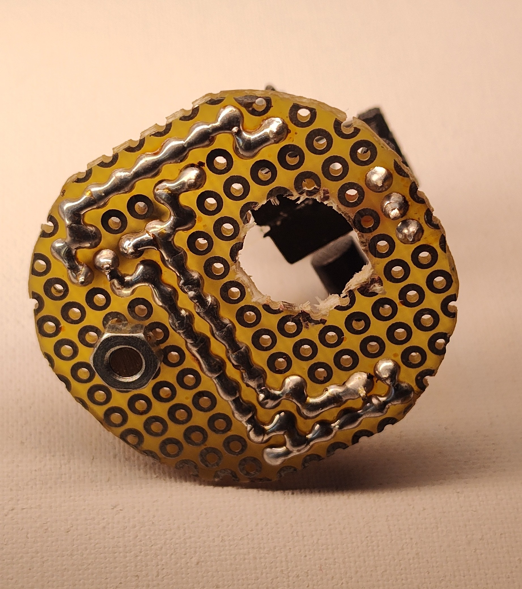
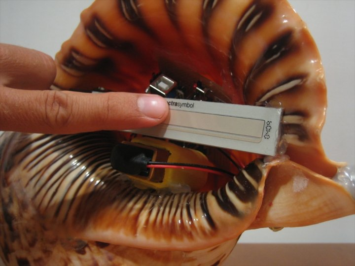
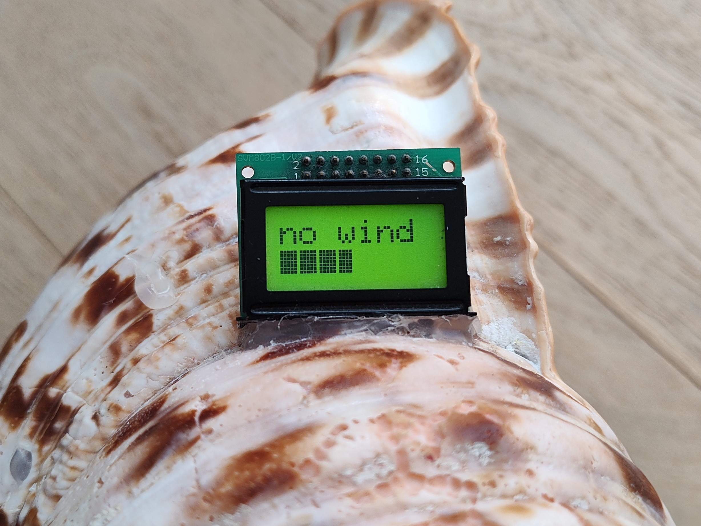
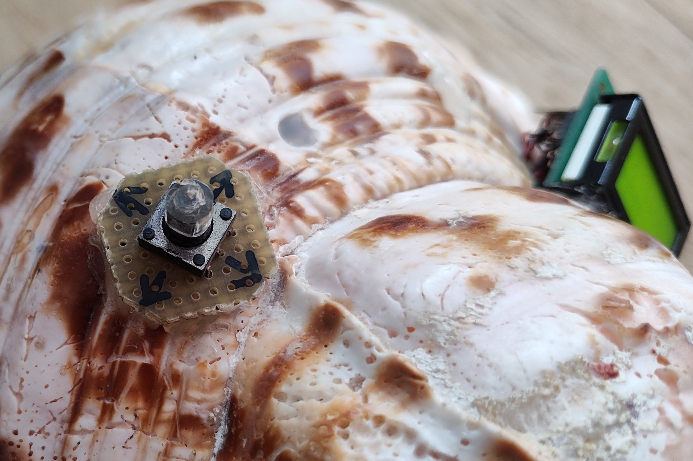
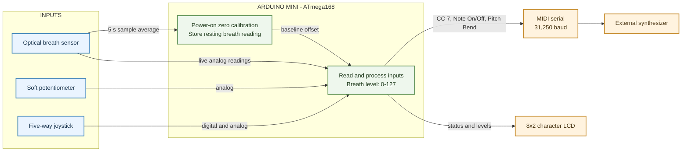
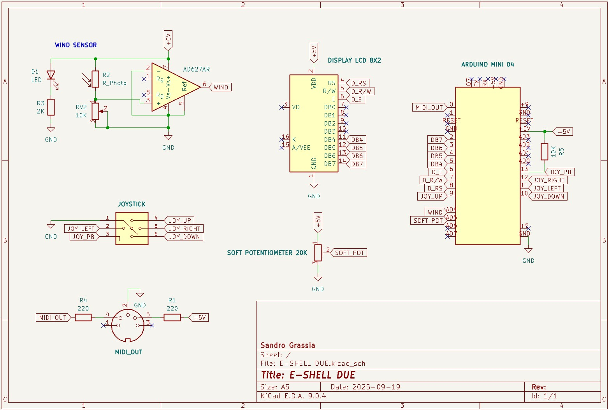

# Midi-Wind-Shell

<p align="center">

</p>

This wind MIDI controller is housed inside a shell. It was designed and built in 2011 using an Arduino Mini 04. Other microcontrollers may also work, provided they have at least two analog inputs and twelve digital GPIO pins.
It can send a root note plus up to four additional notes to an external synthesizer.

Breath pressure controls the volume (MIDI CC 7), and the mouthpiece is mounted on top of the shell.
<p align="center">

</p>

The breath sensor is an optical design made from an LED, a photoresistor, and a dark barrier. Breath moves the barrier, changing how much light from the LED reaches the photoresistor.

<p align="center">

</p>

<p align="center">

</p>

Inside the shell, a soft potentiometer provides pitch modulation.
<p align="center">

</p>

A simple 8×2 character LCD with a parallel interface displays the breath level and pitch-bend position.

<p align="center">

</p>

A five-way joystick selects the root note and note cluster. It also lets you configure the MIDI channel, pitch-bend range, and pitch-bend message format (MSB and LSB, or MSB only).

<p align="center">

</p>

## R3.5 Y26 ? 2026-11-27

The release identifier is defined in `include/config.h`. The compiled firmware for Arduino Mini ATmega168 is [R3.5_Y26.hex](firmware/R3.5_Y26.hex).

- Fixed stuck notes after multiple root-note or chord selections: Note Off now uses the exact sounding notes and their original channel.
- Guaranteed silence at the end of every breath, including small volume changes inside the controller deadband.
- Prevented out-of-range chord tones from corrupting MIDI messages.
- Removed serial debug text from the MIDI output.
- Synchronized pitch centering and pitch-bend range with the synthesizer when leaving setup or changing MIDI channel.
- Reworked setup as a non-blocking menu with a debounced center button. Holding the center button no longer repeatedly opens and closes setup; playing resumes on the next loop after exit if breath is present.
- Preserved startup breath calibration when entering setup, made joystick repeat timing rollover-safe, and fitted all four chord intervals on the LCD.
- Reduced static RAM usage to 708 bytes out of 1024, compared with 795 bytes in the reviewed working copy.

Note Off remains deferred until the next breath attack, as in previous versions. End-of-breath silence is controlled by CC7 = 0. Setup immediately sends Note Off and resets playback state.

### Regression checks

The host tests compile the actual firmware against simulated Arduino inputs and capture outgoing MIDI bytes. They cover repeated joystick selection, exact Note Off matching, all 8,320 root/chord combinations, volume zero, menu navigation, channel configuration, and playback after setup.

From the repository root with a C++11 compiler:

```powershell
g++ -std=c++11 -Wall -Wextra -static -Itest/host -Iinclude test/host/regression.cpp -o .pio/regression.exe
& .pio/regression.exe
```

Run `pio run` first to build the AVR firmware and create `.pio`. Host tests do not replace a hardware test with the actual sensors and synthesizer.

## Build

Open the repository root in Visual Studio Code with the PlatformIO IDE extension installed, then run **PlatformIO: Build**.

Alternatively, from a PlatformIO terminal in the repository root, run:

```sh
pio run
```

The `platformio.ini` file targets the Arduino Mini ATmega168 and declares the LiquidCrystal dependency. PlatformIO installs the required build tools and library automatically. The compiled firmware is written to `.pio/build/miniatmega168/firmware.hex`.

On Windows, if PlatformIO is installed in its default location but `pio` is not on your PATH, use PowerShell:

```powershell
& "$env:USERPROFILE/.platformio/penv/Scripts/platformio.exe" run
```

## Technical overview

The controller reads an optical breath sensor, a soft potentiometer, and a five-way joystick. It maps the breath sensor reading to a 7-bit value from 0 to 127 (128 levels), which controls MIDI volume (Control Change 7). A value of 3 or higher triggers a Note On for the selected root note and chord; before that, the controller sends Note Off for the exact notes previously transmitted, on their original MIDI channel. Joystick changes affect the next attack without overwriting that active-note snapshot. Chord tones above MIDI note 127 are omitted. When the breath value falls below 1, the controller always sends CC7 = 0 and resets the breath-detection state so another note can be triggered; this transition does not itself send Note Off. This preserves the existing articulation: notes remain active silently until the next attack or until setup is opened. The soft potentiometer controls pitch bend, while the joystick selects the root note and chord and provides access to the MIDI channel, pitch-bend range, and message resolution settings. MIDI data is sent over the serial port at 31,250 baud to an external synthesizer. An 8x2 LCD with a parallel interface displays breath level, pitch bend, and setup information.

### Power-on calibration

At startup, the controller displays `CAL 5s` and takes breath-sensor readings at 10 ms intervals for five seconds, while displaying `NO BLOW`. It averages these readings and stores the result as the zero-pressure offset. Keep the mouthpiece unblown during calibration so the offset represents the sensor's resting level. Subsequent readings are measured relative to this baseline, then mapped and clamped to the 0-127 breath level. This is a one-point zero calibration, not a multi-point calibration. Opening the setup menu preserves this baseline, so entering setup while blowing cannot recalibrate the resting pressure incorrectly. The soft potentiometer is not zero-calibrated at startup; its touch position is tracked when it is first touched.



*Schematics*

<p align="center">

</p>
